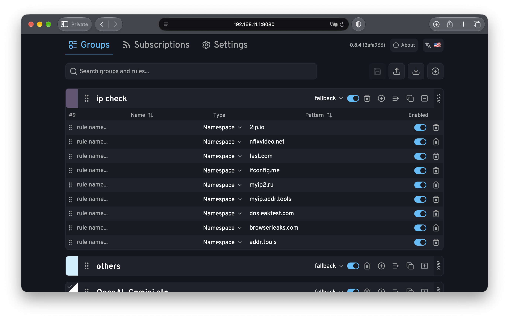
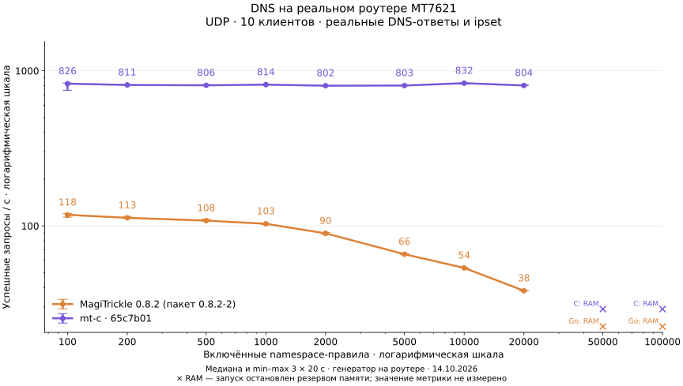
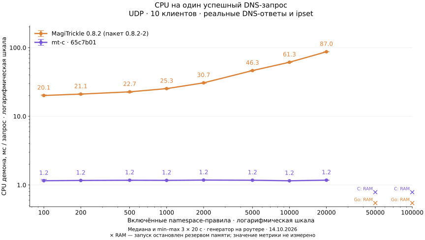
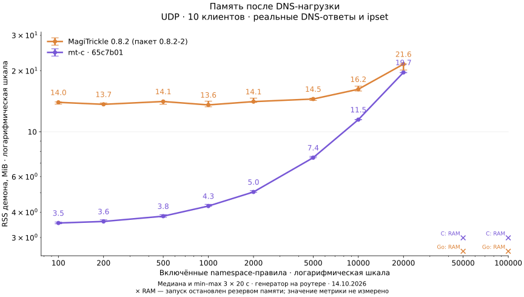

<p align="center">
  
</p>

<p align="center">
  <strong>Точная маршрутизация. Меньше памяти. Больше пропускной способности.</strong>
  <br/>
  <sub>C11-движок для MagiTrickle · Entware / Keenetic · OpenWrt</sub>
</p>

<p align="center">
  <a href="#почему-mt-c">Почему mt-c</a> ·
  <a href="#установка">Установка</a> ·
  <a href="#описание-типов-правил">Типы правил</a> ·
  <a href="docs/swagger.yaml">HTTP API</a>
</p>

**mt-c** — [MagiTrickle](https://magitrickle.dev), полностью переписанный с Go на **C11**. Тот же конфиг, HTTP API и поведение — но заметно меньше накладных расходов на слабом железе роутера.

## Назначение

MagiTrickle (произносится как *Мэджитрикл*, по названию проекта, от которого он унаследован) – утилита для точечной маршрутизации сетевого трафика по заданным доменным именам. Представляет собой установочный пакет, устанавливаемый в дополнение к операционной системе маршрутизатора.

<p align="center">
  
</p>

Принцип работы основан на подмене основного DNS-сервера через промежуточный компонент без его отключения. Это позволяет перехватывать входящие DNS-запросы, кешировать ответы и сопоставлять IP-адреса с доменными именами. Благодаря этому становится возможной маршрутизация трафика без необходимости очистки DNS-кэша на стороне клиентов. Очистка кэша требуется только при запуске или перезапуске сервиса, поскольку в этот момент кэш ещё не прогрет, и маршрутизация невозможна до первого запроса к нужному домену.

## Установка

### Entware/Keenetic: установка из репозитория [feedly](https://github.com/spatiumstas/feedly)

```shell
curl -fsSL https://raw.githubusercontent.com/spatiumstas/feedly/main/add-repo.sh | sh
opkg install mt-c
```

### Установка пакета вручную

Скачайте пакет со страницы [Releases](https://github.com/dan0102dan/mt-c/releases) под вашу платформу, версию OpenWrt и архитектуру роутера.

**Entware/Keenetic:**
```shell
opkg install ./mt-c_<версия>_entware_<архитектура>.ipk
/opt/etc/init.d/S99magitrickle start
```

**OpenWrt (≤ 24.10, opkg):**
```shell
opkg install ./mt-c_<версия>_openwrt-24.10.4_<архитектура>.ipk
service magitrickle start
```

**OpenWrt 25.12+ (apk):**
```shell
apk add --allow-untrusted ./mt-c_<версия>_openwrt-25.12.5_<архитектура>.apk
service magitrickle start
```

## Почему mt-c

Оригинальный MagiTrickle написан на Go. mt-c — полный переписанный движок на C11: тот же формат конфига, тот же HTTP API, то же поведение iptables/ipset (`MT_`/`mt_`-префиксы цепочек и множеств не изменились) — формат YAML совместим. Каждое сознательное расхождение с оригиналом задокументировано (см. `docs/c-rewrite/decisions.md`), молчаливых отличий в поведении нет.

DNS-прокси использует событийный цикл на `epoll`, без рантайма Go и сборщика мусора. Практическую разницу проверяем на пакетных бинарниках и реальном устройстве.

### Сравнение на реальном роутере

Измерено **14.10.2026 на Keenetic с MT7621**: 2 ядра MIPS / 4 логических CPU, 256 МБ RAM, Linux 4.9, Entware glibc 2.27. Сравнивались официальный **MagiTrickle 0.8.2-2** и установленный **mt-c `0.8.5~git20261013213732.65c7b01-1`**. Это результаты конкретных пакетов; mt-c не пересобирался из текущей ветки.

Настоящие DNS-ответы для 32 публичных доменов через штатный DNS роутера, без `dnsstub`. Обе версии используют одинаковый конфиг с **включёнными** namespace-правилами и записывают адреса в отдельные ipset. Привязка тестовых множеств к iptables и маршрутам отключена. Рабочий сервис и остальные службы роутера остаются запущенными.

**1000 правил, UDP, 10 клиентов без пауз.** Медиана трёх прогонов по 20 с; в скобках — min–max:

| Метрика | MagiTrickle (Go) | mt-c |
|---|---|---|
| Успешные запросы/с | 103 (102–104) | **814 (814–820)** |
| CPU демона | 260.6% (257.5–262.2%) | **94.6% (94.5–95.4%)** |
| p95 задержки | 192.44 мс | **16.84 мс** |
| RSS в простое | 12.88 MiB | **4.29 MiB** |
| RSS после нагрузки | 13.58 MiB | **4.29 MiB** |

**При одинаковых 20 запросах/с**, 1000 правил, UDP, три прогона по 30 с:

| Метрика | MagiTrickle (Go) | mt-c |
|---|---|---|
| CPU демона | 34.8% (34.1–34.8%) | **2.6% (2.6–2.7%)** |
| p95 задержки | 23.57 мс | **3.90 мс** |
| Ошибки / таймауты, всего | 0 / 0 | 0 / 0 |

**На действующем наборе правил роутера** — 13 групп, 214 статических правил и 8491 сохранённое правило подписки (всего 8705), те же 20 запросов/с, UDP, 3×30 с:

| Метрика | MagiTrickle (Go) | mt-c |
|---|---|---|
| CPU демона | 85.8% (83.9–87.5%) | **2.4% (2.4–2.4%)** |
| p95 задержки | 64.87 мс | **3.47 мс** |
| RSS после нагрузки | 15.12 MiB | **10.18 MiB** |
| Ошибки / таймауты, всего | 0 / 0 | 0 / 0 |

Значения и типы правил сохранены; интерфейсы заменены тестовыми, обновление подписки отключено. Сам пользовательский конфиг и адреса подписки в репозиторий не включены. [Подробности этой серии](docs/c-rewrite/router-raw/2026-10-14/live-rules/summary.md).

100% CPU здесь означает один логический процессор. Генератор работает на роутере и расходует CPU отдельно: при 1000 правилах и нагрузке без пауз около 22% для Go и 111% для mt-c. Поэтому RPS показывает предел всей тестовой связки — демона, генератора и штатного DNS; это не скорость интернет-канала. RSS включает общие страницы библиотек, PSS на этом ядре недоступен.

<p align="center">
  
</p>

<p align="center">
  
</p>

Графики используют **логарифмические шкалы обеих осей**: UDP, 10 клиентов; измеренные точки — 100, 200, 500, 1000, 2000, 5000, 10 000 и 20 000 правил. На 50 000 и 100 000 оба пакета остановлены защитой памяти при загрузке (3 проверки на пакет и размер; для Go на 50 000 была ещё первоначальная попытка). Отметки «× RAM» обозначают остановку по резерву RAM/swap, **без значения RPS**, а не нулевую скорость. Это предел защищённого теста на работающем устройстве, а не общий предел этих пакетов. На графике CPU показано процессорное время на успешный ответ, чтобы сравнивать стоимость обработки при разной пропускной способности. Задержка включает установку TCP-соединения в TCP-сериях. Полные таблицы содержат ошибки, таймауты и разброс; небольшие различия внутри разброса не считаются преимуществом.

<p align="center">
  
</p>

На измеренном диапазоне процессорная стоимость Go описывается приблизительно линейной зависимостью: **22.81 мс + 0.00340 мс × число правил**, R² = 0.976 (МНК по медианам восьми точек). У mt-c она остаётся около **1.2 мс на успешный ответ**; скорость ограничивается также генератором и upstream. Это эмпирическая зависимость данного сценария, без экстраполяции за 20 000 правил. Рост RSS показывает, что ровная скорость не означает постоянный расход памяти.

[Сырые результаты и таблицы](docs/c-rewrite/router-raw/2026-10-14/) · [Пакеты и SHA-256](docs/c-rewrite/router-raw/2026-10-14/packages.json) · [Методика и воспроизведение](tools/bench/router-benchmark.md).

Это контролируемая нагрузка с реальными DNS-ответами, а не запись трафика пользователей. Измеряются DNS, активные правила, кэш и обновление ipset; пересылка пакетов через iptables, холодная рекурсия и длительная стабильность этим тестом не проверялись. Старое host-сравнение снято из README: при выключенной группе Go продолжал перебор правил, а C исключал группу из сопоставления — одинаковым полным конвейером такой тест не был ([D-80](docs/c-rewrite/decisions.md#d-80--correct-the-benchmarks-disabled-group-bias-2026-10-14)).

## Профили интерфейсов

Профили позволяют объединить несколько интерфейсов в упорядоченную цепочку резервирования. Трафик направляется через первый доступный, а при его отказе автоматически переключается на следующий. Выбор осуществляется с учётом локального состояния интерфейса, IP-адреса и шлюза.

## Приоритет групп и подписок

Приоритет задаётся числом от **1 до 999**: чем выше значение, тем предпочтительнее выбор. Если IP-адрес попадает в несколько включённых групп или подписок, используется интерфейс объекта с наибольшим значением. При равенстве **группа имеет преимущество перед подпиской**.

## Описание типов правил

### Namespace (Именное пространство)

Охватывает указанный домен и все его поддомены.

Например, при записи `example.com` будут обрабатываться:
```
✅ example.com
✅ sub.example.com
✅ sub.sub.example.com
❌ anotherexample.com
❌ example.net
```

### Wildcard (Подстановочный шаблон)

Шаблон с `*` и `?` — позволяет задавать гибкие условия:
- `*` — любое количество любых символов
- `?` — ровно один любой символ

Например, при записи `*example.com` будут обрабатываться:
```
✅ example.com
✅ sub.example.com
✅ sub.sub.example.com
✅ anotherexample.com
❌ example.net
```

### Domain (Точный домен)

Правило применяется только к строго указанному домену, без поддоменов.

Например, при записи `sub.example.com` будут обрабатываться:
```
❌ example.com
✅ sub.example.com
❌ sub.sub.example.com
❌ anotherexample.com
❌ example.net
```

### RegExp (Регулярное выражение)

Для опытных пользователей. Используется движок [PCRE2](https://www.pcre.org/).

Например, при записи `^[a-z]*example\.com$` будут обрабатываться:
```
✅ example.com
❌ sub.example.com
❌ sub.sub.example.com
✅ anotherexample.com
❌ example.net
```

## Поддержка

* [Официальный сайт](https://magitrickle.dev)
* [Форум на Keenetic Community](https://forum.keenetic.ru/topic/20125-magitrickle)
* [Канал Telegram](https://t.me/MagiTrickle)
* [Чат Telegram](https://t.me/MagiTrickleChat)
* [Финансовая поддержка](https://boosty.to/magitrickle)
